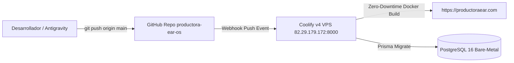

# EAR OS V2 — PRODUCTORA EAR S-CLASS (OMEGA v9.0)

[](https://www.typescriptlang.org/)
[](https://nextjs.org/)
[](https://www.postgresql.org/)
[](http://82.29.179.172:8000)
[](./docs/MANUAL_OPERATIVO_SCLASS_2026.md)

---

## 🏛️ SOBERANÍA OPERATIVA Y ARQUITECTURA BARE-METAL

EAR OS V2 es el sistema operativo comercial, logístico y contractual de **Productora EAR**. Funciona bajo la doctrina de soberanía tecnológica e infraestructura Bare-Metal privada, erradicando intermediarios y dependencias de PaaS comerciales.

- **Servidor Central:** Hostinger VPS Bare-Metal Ubuntu 24.04 LTS (`82.29.179.172:8000`).
- **Orquestador CI/CD:** Coolify v4 con despliegue automatizado por Webhook sobre la rama `main`.
- **Base de Datos:** PostgreSQL 16 con persistencia de volumen y pool de conexiones Prisma.
- **Cluster de Automatización:** n8n S-Class activo en `https://n8n.productoraear.com`.
- **Dominio Canónico:** `https://productoraear.com` | **Atención:** `+34 693 693 048`.

---

## 📜 REGLAS DE NEGOCIO INMUTABLES (SSOT)

Todas las transacciones y cálculos monetarios nacen exclusivamente de `src/lib/constants/ear-os-ssot.ts` bajo la custodia criptográfica de `src/lib/security/ssotIntegrityGuard.ts`:

1. **Tarifa Base Solista (Edwin Agudelo):** `350,00 €` (+21% IVA = `423,50 €`).
2. **Depósito Price-Lock:** `100,00 €` en Stripe Checkout (100% deducible de la liquidación final).
3. **Split Soberano (80/10/10):**
   - **80% Artista:** `280,00 €` (Retribución directa y digna).
   - **10% EAR OS:** `35,00 €` (Infraestructura, telemetría y hosting).
   - **10% VIMUME:** `35,00 €` (Mecenazgo de neuroacústica 40Hz, deducible IRPF/IS Ley 49/2002 Modelo 182).
4. **Logística S-Class:** `1,50 €/km` a partir del km 50 (+120 € hotel si fin ≥ 3:00 AM o distancia > 200 km).
5. **Rider Acústico Calibrado:** `< 75 dB SPL`, 12 W/pax (Ley 37/2003 del Ruido).
6. **Techo B2G Contrato Menor:** `< 15.000,00 €` (Tope preventivo SSOT: `14.250,00 €`, Art. 118 LCSP).

---

## 🗺️ NAVEGACIÓN Y AUDITORÍA FORENSE

El ecosistema cuenta con un sitemap canónico auditado al 100% de disponibilidad (30/30 rutas con HTTP `200 OK`, latencia < 50ms):

- 🧭 **[Sitemap Navegable Canónico (30/30 URLs)](./docs/SITEMAP_NAVEGABLE_CANONICO_2026.md)**
- 📖 **[Manual Operativo y Guía de Despliegue S-Class](./docs/MANUAL_OPERATIVO_SCLASS_2026.md)**
- 🎯 **[Centro de Mando S-Class](./docs/00_CENTRO_DE_MANDO_SCLASS.md)**
- 🛡️ **[Auditoría Forense Master Ω-Diamante](./docs/MASTER_AUDIT_OMEGA_DIAMANTE_2026.md)**

---

## 🚀 CICLO DE DESPLIEGUE EN PRODUCCIÓN (COOLIFY BARE-METAL)

El despliegue a producción es 100% soberano y automatizado:



### Comandos de Despliegue:

```powershell
# 1. Comprobar que no existen tipos rotos ni ': any'
npx tsc --noEmit

# 2. Auditar todas las URLs en local
node scripts/audit_sitemap_live.cjs

# 3. Enviar a producción (dispara Coolify automáticamente)
git add -A
git commit -m "feat(omega): release to hostinger vps bare-metal"
git push origin main
```

---

## 📂 ESTRUCTURA DEL PROYECTO

- `src/app/(public)`: Embudos de captación, catálogo de servicios, páginas informativas y portales B2B.
- `src/app/(dashboard)`: Paneles de control y telemetría de reservas, liquidaciones, proveedores y licitaciones.
- `src/app/api`: Endpoints REST seguros con validación Zod, firma HMAC-SHA256, persistencia Prisma y webhooks n8n.
- `src/lib/constants/ear-os-ssot.ts`: **Zona Cero** inmutable con las constantes del negocio.
- `src/lib/security`: Sentinel criptográfico y guardianes de integridad.
- `src/lib/contracts`: Motor generador de contratos inteligentes con validez jurídica eIDAS.
- `src/lib/finance`: Motores de liquidación, reparto del Split 80/10/10 y facturación.
- `scripts`: Batería de auditoría forense, crawlers y verificadores automatizados.

---
© 2026 Productora EAR | S-Class Bare-Metal Infrastructure
