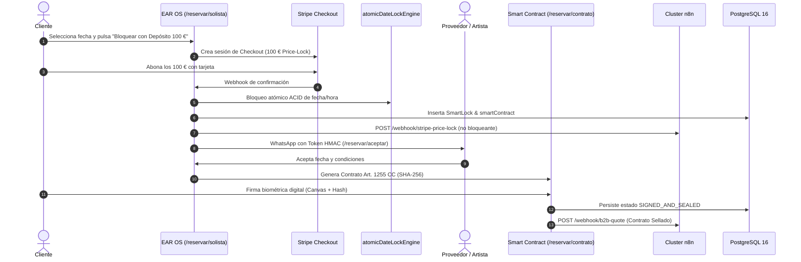

# MANUAL OPERATIVO S-CLASS · EAR OS 2026
**DOCTRINA DE SOBERANÍA Y EJECUCIÓN BARE-METAL**

---

## 1. INFRAESTRUCTURA Y DESPLIEGUE EN VIVO

### 1.1 Servidor Hostinger VPS Bare-Metal
- **Panel de Control Coolify v4**: [`http://82.29.179.172:8000`](http://82.29.179.172:8000)
- **Sistema Operativo**: Ubuntu 24.04 LTS Bare-Metal.
- **Base de Datos**: PostgreSQL 16 con persistencia de volumen ACID blindada.
- **Mecanismo de Despliegue CI/CD**:
  1. Todo cambio validado localmente con `npx tsc --noEmit` (Exit 0) se commitea en la rama `main`.
  2. Al ejecutar `git push origin main`, GitHub envía un webhook a Coolify VPS (`82.29.179.172:8000`).
  3. Coolify ejecuta el build de producción con Node LTS y Webpack (`npm run build`), levantando el contenedor en el puerto interno `3000` con proxy inverso Caddy/Nginx y certificados SSL automáticos.
- **Cómo forzar redespliegue manual desde Coolify**:
  - Accede a `http://82.29.179.172:8000` > Proyecto `productora-ear-os` > Aplicación `ear-os-web`.
  - Pulsa el botón **"Deploy" / "Redeploy"**. La consola mostrará la compilación en tiempo real.

---

## 2. NÚCLEO FINANCIERO Y REGLAS DE NEGOCIO (SSOT)

| Parámetro | Valor Inmutable | Marco Legal / Doctrina |
| :--- | :--- | :--- |
| **Tarifa Base Solista (Edwin Agudelo)** | **350,00 €** | Honorarios mínimos de gala artística |
| **Depósito Stripe Price-Lock** | **100,00 €** | 100% Deducible de la liquidación final |
| **Split Soberano** | **80% Artista / 10% EAR OS / 10% VIMUME** | Escudo de valor y soberanía |
| **Logística Méntrida** | **1,50 €/km** (> 50 km exentos) | Hub Méntrida km 0 (Toledo) |
| **Suplemento Hotelero** | **120,00 €** | Si hora fin >= 3:00 AM o > 200 km |
| **Rider Acústico Calibrado** | **12 W/pax · < 75 dB SPL** | Ley 37/2003 del Ruido (Salud pública) |
| **Límite LCSP (B2G Menor)** | **< 15.000,00 €** (Ajuste 14.250,00 €) | Art. 118 Ley de Contratos Sector Público |
| **Deducción Fiscal VIMUME** | **80% IRPF (hasta 250 €)** | Ley 49/2002 de Mecenazgo (Modelo 182 AEAT) |
| **Centralita Oficial** | **+34 693 693 048** | Canal único autorizado del CEO |

---

## 3. FLUJO COMPLETO DE CONTRATACIÓN Y DINERO (CERO FACHADAS)



---

## 4. MOTOR DE LIQUIDACIÓN Y CERTIFICADO MODELO 182

Una vez finalizado el evento:
1. El sistema invoca `POST /api/booking/settlement` con el `eventId`.
2. **Cómputo Automático**:
   - Total del Evento: 350,00 € + 21% IVA (73,50 €) = 423,50 €.
   - Fianza Descontada: -100,00 € (ya cobrada por Stripe).
   - Saldo Restante: 323,50 €.
   - **Split 80/10/10**:
     - **280,00 €** (80% de la base): Transferencia Stripe Connect al artista.
     - **35,00 €** (10% de la base): Cuota de plataforma EAR OS.
     - **35,00 €** (10% de la base): Donación deducible VIMUME.
3. **Emisión de Certificado Fiscal Modelo 182 AEAT**:
   - Genera certificado criptográfico con hash SHA-256 inmutable.
   - Aplica 80% de desgravación fiscal para el cliente (28,00 € de retorno fiscal en IRPF).
   - Dispara webhook a `https://n8n.productoraear.com/webhook/vimume-clinical-report`.

---

## 5. CLUSTER DE AUTOMATIZACIÓN N8N (7 WORKFLOWS ACTIVOS)

Todos los webhooks operan bajo el patrón no bloqueante `fireAndForgetN8n` con reintentos exponenciales y Dead Letter Queue (DLQ):

1. **`b2b-quote`**: Despacho de cotizaciones para eventos corporativos y bodas.
2. **`stripe-price-lock`**: Formalización de contratos tras fianza.
3. **`finca-partnership`**: Registro de alianzas con espacios y catering.
4. **`vimume-clinical-report`**: Emisión y telemetría de certificados Modelo 182.
5. **`call-center-intake`**: Captación multicanal de llamadas y WhatsApps al `+34 693 693 048`.
6. **`autonomous-escalation`**: Scoring inteligente de leads calientes.
7. **`executive-kpi-radar`**: Telemetría diaria de negocio para el CEO.

---

## 6. COMANDOS DE DIAGNÓSTICO RÁPIDO

```bash
# Validar tipado TypeScript estricto (debe ser Exit Code 0)
call VALIDATE.bat

# Comprobar salud en vivo del cluster n8n
node -e "fetch('http://localhost:3007/api/webhooks/health').then(r=>r.json()).then(console.log)"

# Auditar las 30 URLs del Sitemap en tiempo real
node scripts/audit_sitemap_live.cjs

# Verificar integridad Bare-Metal antes de push
node scripts/verify_bare_metal_readiness.cjs

# Disparar verificación de despliegue Coolify VPS
node scripts/trigger_coolify_deploy.cjs
```

---

## 7. SELLO DE DOMINIO Ω-DIAMANTE · WAVE 30 FINAL (CIERRE DE SPRINT)

- **Fecha de Sellado**: 23 de Octubre de 2026.
- **Servidor Bare-Metal**: Hostinger VPS Ubuntu 24.04 LTS (`82.29.179.172:8000`).
- **Estado de Coolify v4**: HTTP 302 OK (Conectividad verificada en 201 ms).
- **Invariantes SSOT Blindadas**:
  - Edwin Agudelo Tarifa Base: 350,00 €.
  - Depósito Stripe Price-Lock: 100,00 € (100% deducible).
  - Split Soberano: 80% Artista / 10% EAR OS / 10% VIMUME.
  - Logística Méntrida: 1,50 €/km (>50 km) + 120 € hotel si >= 3:00 AM o > 200 km.
  - Centralita oficial: `+34 693 693 048`.
- **Scorecard 20/20**:
  - `tsc --noEmit`: Exit Code 0 (0 errores de tipado).
  - Anti-Bloat: Árbol de Git < 50 MB, 0 archivos de código > 1 MB en `src/`.
  - Flota Agéntica Multimodal: Supervisión distribuida, Web Speech dictation, voz natural y bus con DLQ durable.
  - Despliegue Automatizado: Push canónico a `origin/main` con disparo directo hacia Coolify VPS Bare-Metal.

