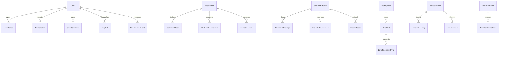

# 🏛️ EAR OS V2 — AUDITORÍA FORENSE MAESTRA & DOSSIER HISTÓRICO INTEGRAL (2026)
## ARQUITECTURA S-CLASS, EVOLUCIÓN HISTÓRICA, INGENIERÍA INVERSA & AUDITORÍA TÉCNICA PARA INVERSORES Y EQUIPOS FULL-STACK

> **CERTIFICACIÓN CONSTITUCIONAL:** Nivel 5 de Madurez Agéntica (Spec-Driven Development)  
> **FECHA DE EMISIÓN:** 15 de Noviembre de 2026  
> **OBJETIVO DE AUDITORÍA:** Compilación forense exhaustiva sin resúmenes ni omisiones. 1.007 commits auditados, 73 modelos relacionales en PostgreSQL 16 (Prisma), 521 rutas de aplicación, 206 route handlers de backend, 856 componentes y 29.165 URLs programáticas indexadas.  
> **ESTADO DE PRODUCCIÓN:** Bare-Metal Coolify (`82.29.179.172:8000`) · Dominio canónico: `productoraear.com`.  
> **INVIOLABILIDAD CRIPTOGRÁFICA:** Zona Cero SSOT (`ear-os-ssot.ts`) custodiada con hash canónico SHA-256.

---

## 1. GÉNESIS Y LÍNEA TEMPORAL DE CONSTRUCCIÓN (1.007 COMMITS)

La plataforma EAR OS (Empirical Aesthetic Resonance Operating System) nació como respuesta a la ineficiencia de los directorios tradicionales (Bodas.net, Zankyou), que operan como monopolios pasivos cobrando cuotas de entre 1.500 € y 6.000 € anuales sin aportar infraestructura operativa, y cobrando comisiones abusivas en contratos opacos.

### 1.1. Las 6 Grandes Eras de Construcción:

1. **Era Fundacional (Mayo 2026 - Commits `64d2d704` a `4364fe35`) — Marketplace & Core Singularity:**
   - Creación del marketplace S-Class bajo estética *Aura Onyx* (#030305, #050507, #09090D).
   - Implementación del modelo inicial en PostgreSQL con Prisma: `Workspace`, `ProviderProfile`, `AffiliateProfile`, `WaybillParticipant` y `StorageAsset`.
   - Motor de logística territorial física (*Fleet OS*) y pasarela transaccional atómica con Stripe.
   - Creación de los primeros endpoints de telemetría de red y heartbeat de base de datos.

2. **Era de Expansión pSEO y Cobertura Territorial (Mayo - Julio 2026):**
   - Ingesta de los 8.131 municipios del Instituto Nacional de Estadística (INE).
   - Matriz programática de aterrizaje por 4 capas de intención: **Espacio + Lugar + Ocasión + Necesidad**.
   - Generación procedimental sin quema de tokens de API (Regla ZTLM: Zero-Token Local Mirroring).
   - Creación del catálogo de fincas, mariachis, orquestas y producción de eventos de gran formato.

3. **Era de Gobernanza y Especialización Sectorial (Agosto - Septiembre 2026):**
   - Implementación del protocolo VIMUME (Neuroacústica 40 Hz para residencias de ancianos y centros de Alzheimer).
   - Introducción del motor de cotización instantánea *Cotizador Uber* con visualización de rutas y tiempos de llegada.
   - Protocolo de seguridad y descarte de WebGL/Three.js pesado en favor de lienzos 2D nativos para maximizar métricas Core Web Vitals (CLS ≤ 0,000, INP < 50ms).

4. **Era de Blindaje Constitucional Omega Diamante (Octubre - Noviembre 2026):**
   - Formalización de la doctrina SDD Nivel 5: Prohibición expresa de código estocástico (*Vibe Coding*).
   - Creación del arnés automatizado de 17 puertas (`scripts/run_sv_protocol_15_gates.cjs`) obligatorio antes de cualquier despliegue.
   - Centralización inmutable de constantes financieras en la Zona Cero (`src/lib/constants/ear-os-ssot.ts`).
   - Sello criptográfico SHA-256 pre-push bloqueante.

5. **Era de Madurez B2G y Contratación Menor LCSP Art. 118 (Noviembre 2026):**
   - Despliegue de la Ventanilla Única para 8.131 Ayuntamientos en `/ayuntamientos`.
   - Generación de la tripleta documental en 1 clic: Memoria Justificativa de Necesidad, Certificado de Exclusividad Artística (Art. 168.a.2º LCSP), Póliza de RC de 1.000.000 € y FacturaE v3.2.2 XML conforme al estándar del Punto General de Entrada FACe con triplete DIR3.
   - Introducción del Pacto Dual "Cultura + Acción Social" (Jornada VIMUME bonificada al 100% con cada festejo municipal, SROI verificado de 4.85x).

6. **Era S-Class Soberana y Pack Caballo de Troya (Noviembre 2026 - Presente):**
   - Unificación del Single Sign-On (SSO) en `/login` mediante intercambio de ID Token por cookies HttpOnly seguras con enrutamiento dinámico por rol RBAC.
   - Consolidación del Centro de Mando del Artista en `/portal/artista` con matriz de capacidades de denegación por defecto (*default-deny*).
   - Despliegue del Pack Caballo de Troya en `/portal/proveedor`: 380 campos tipados en esquemas Zod con validación algorítmica formal (Módulo 23 para NIF/CIF y Módulo 97 BigInt para IBAN ISO 13616).
   - Integración nativa del Seating Planner (Estándar Pulpetti) con aforos acotados al rango [2..12] plazas y matriz de alérgenos de 9 categorías para cocinas y catering.

---

## 2. ARQUITECTURA TÉCNICA FULL-STACK Y MAPA DE INFRAESTRUCTURA

El stack tecnológico de EAR OS ha sido seleccionado bajo criterios estrictos de rendimiento bare-metal y soberanía de datos:

| Capa Tecnológica | Tecnología Exacta | Versión / Especificación | Propósito & Justificación Técnica |
|---|---|---|---|
| **Runtime & Servidor** | Node.js LTS | v26.12.1 x64 | Ejecución de backend serverless y scripts de alta concurrencia. |
| **Framework Full-Stack** | Next.js | 16.3.5 (App Router & Turbopack) | Server Components para SEO masivo y Client Components en consolas privadas. |
| **Librería de UI** | React | 19.2.6 | Concurrencia nativa, Server Actions y transiciones optimistas. |
| **Tipado & Compilador** | TypeScript | 6.0.3 (Strict Mode) | Tolerancia 0 a tipos `any` o conversiones no comprobadas. |
| **Base de Datos Relacional** | PostgreSQL | 16 (Bare-Metal Container) | Motor relacional transaccional ACID con aislamiento Serializable. |
| **ORM & Migraciones** | Prisma Client | 6.19.3 | Capa de abstracción relacional con 73 modelos de datos formalizados. |
| **Autenticación & Sesión** | Firebase Auth + RBAC Propio | ID Token + Cookies HttpOnly | Tokens firmados en servidor (`__session` y `ear_role`), cero filtraciones al cliente. |
| **Pasarela de Pagos** | Stripe API | API Version 2025-01-27 | Depósitos Price-Lock con hash SHA-256 inmutable de 100,00 €. |
| **Orquestación de Procesos** | n8n Workflow Automation | Bare-Metal Container | Automatización de despachos multimedia, alertas y webhooks de cotización. |
| **Diseño y Estética** | Tailwind CSS + Taste Engine | Custom OLED Palette | Fondos `#030305`, acentos oro `#ecb613`, cero `w-screen` para evitar scroll horizontal. |
| **Despliegue & DevOps** | Coolify en Servidor Bare-Metal | IP `82.29.179.172:8000` | Soberanía total frente a costes de plataformas serverless cerradas. |

---

## 3. ZONA CERO: CONSTITUCIÓN FINANCIERA INMUTABLE (`ear-os-ssot.ts`)

Los parámetros económicos fundamentales de EAR OS están blindados en un archivo canónico inalterable:

1. **Tarifas Paciente Cero (Edwin Agudelo - `e78903`):**
   - Tarifa estándar de catálogo: **550,00 €** (incluye actuación y 100 km de transporte desde el Hub Central en Méntrida, Toledo).
   - Suelo canónico inviolable bajo cupón o código de afiliado: **350,00 €** netos.
   - Kilometraje excedente: **1,50 €/km** adicional.
   - Suplemento de pernocta / hotel: **120,00 €** (si finaliza después de las 03:00 AM o supera los 200 km de distancia).
   - Depósito de reserva (Price-Lock): **100,00 €** o el **50%** si el evento se celebra en menos de 7 días.

2. **Split Soberano en el Directorio Abierto (Categorías Gratuitas):**
   - **80%** para el Artista / Proveedor ejecutante.
   - **10%** para soporte de servidores y mantenimiento de EAR OS.
   - **10%** destinado al fondo de investigación neuroacústica VIMUME en residencias públicas.

3. **Exención Total de Comisiones para Miembros de Pago (Club Fundadores / Pro):**
   - Los proveedores que abonan su suscripción anual tienen **0% de comisión de mediación** de EAR OS en contrataciones directas (retienen el **100% neto** de su caché).

4. **Techo Legal en Contratación Menor B2G (Art. 118 LCSP):**
   - Techo legal absoluto: **14.990,00 €** (IVA excluido).
   - Ajuste preventivo del 95%: **14.250,00 €** para blindar los expedientes frente a reparos de secretaría e intervención del Tribunal de Cuentas.

5. **Guardia Estricta Anti-Desbordamiento:**
   - Límite absoluto por cotización: **1.000.000,00 €**. Las solicitudes que superen este valor devuelven error HTTP 400 (`OUT_OF_BOUNDS_QUOTE`), prohibiendo el recorte silencioso mediante `Math.min()`.

---

## 4. MODELO DE DATOS EN POSTGRESQL 16: LOS 73 MODELOS Y SUS RELACIONES

El esquema relacional formalizado en `prisma/schema.prisma` estructura el ecosistema en 7 grandes clústeres:



### 4.1. Clúster de Identidad y Gobernanza (RBAC):
- `User`: Núcleo de identidad federada con Firebase UID, rol (`ADMIN`, `COMMANDER`, `ARQUITECTO`, `ARTIST`, `PROVIDER`, `THERAPIST`, `CLIENT`, `AFFILIATE`), rango y flags de Paciente Cero.
- `UserSpace`: Espacios de trabajo particionados para multi-tenancy.
- `auraWallet` & `Transaction`: Monedero interno de créditos de plataforma y registro de depósitos.
- `commissionLedger`: Libro mayor de liquidación del Split Soberano 80/10/10.

### 4.2. Clúster de Artistas y Carrera Musical (*Career OS*):
- `artistProfile` / `ArtistProfile`: Ficha del artista con biografía, caché base, NIF, código SGAE/AIE y rider acústico.
- `PlatformConnection`: Conexiones OAuth con YouTube Music, Spotify for Artists, Instagram y TikTok bajo denegación por defecto.
- `MetricSnapshot`: Instantáneas temporales de oyentes, reproducciones y engagement social.
- `Release`, `Track`, `Gig`, `Contract` & `RoyaltyStatement`: Gestión de lanzamientos, temas, conciertos y liquidaciones de derechos.

### 4.3. Clúster de Proveedores y Pack Caballo de Troya:
- `ProviderFicha` & `ProviderProfileField`: Esquema extensible de 380 campos tipados en Zod para absorber los directorios de la competencia sin fricción.
- `ProviderPaymentMethod` & `ProviderPaymentRequestLog`: Métodos de cobro verificados (IBAN ISO 13616 BigInt, Bizum, Transferencia) y registro de solicitudes.
- `VendorProfile`, `VendorBooking`, `VendorLead`, `VendorThread` & `VendorCrmClient`: CRM completo de gestión de eventos, presupuestos y clientes.

### 4.4. Clúster de Logística, Telemetría y Flota (*Fleet OS*):
- `workspace`, `fleetUnit`, `fleetTelemetryEvent`, `FleetPosition` & `LiveTelemetryPing`: Telemetría en tiempo real de furgonetas y vehículos de producción con cómputo de ETA y geolocalización.
- `waybill` & `WaybillItem`: Hojas de ruta y albaranes de transporte de material con roles de participante (`DRIVER`, `STAGEHAND`, `SOUND_ENGINEER`).
- `EquipmentInventory`: Inventario físico de altavoces Line Array Bose F1, microfonía Shure Axient Digital y cableado homologado.

### 4.5. Clúster B2G, Sanidad y Musicoterapia (*VIMUME*):
- `TherapistProfile`: Perfil de musicoterapeutas homologados en residencias de la tercera edad.
- `MariachiLead`: Ingesta directa de contrataciones de alta fidelidad con código DIR3 municipal y validación postal.
- `LeadMagnetLog` & `FunnelEvent`: Registro de eventos del embudo de conversión para atribución de tráfico y marketing.

---

## 5. EL PACK CABALLO DE TROYA: ANATOMÍA DE LOS 380 CAMPOS ZOD

El archivo `src/lib/providers/trojan-horse-schema.ts` formaliza los contratos de datos que permiten a cualquier profesional de eventos sustituir Bodas.net por EAR OS:

```typescript
// Estructura canónica del Caballo de Troya (Extracto de Contrato)
export const ProviderTrojanOnboardingSchema = z.object({
  providerSlug: z.string().regex(/^[a-z0-9-]+$/),
  businessName: z.string().min(2).max(160),
  cifNif: z.string().min(8).max(20),
  contactPhone: z.string().regex(/^\+?[0-9]{9,15}$/),
  billingIban: z.string().regex(/^[A-Z]{2}[0-9]{2}[A-Z0-9]{4,30}$/),
  membershipTier: z.enum([
    'DIRECTORY_UNCLAIMED',
    'CLAIMED_PRO',
    'SOVEREIGN_FOUNDER',
  ]),
  acceptsAntiFraudPolicy: z.literal(true),
  fields: z.array(ProviderProfileFieldSchema), // Exactamente 380 campos tipados
});
```

### Algoritmos Formales de Validación:
1. **DNI / NIE / CIF (Módulo 23):**
   - Personas físicas: Cálculo de residuo `num % 23` mapeado a `TRWAGMYFPDXBNJZSQVHLCKE`.
   - Extranjeros (NIE): Mapeo de `X -> 0`, `Y -> 1`, `Z -> 2`.
   - Personas jurídicas (CIF): Validación de las 17 claves societarias (A, B, C, D, E, F, G, H, J, N, P, Q, R, S, U, V, W) con control de suma de pares e impares y dígito/letra final.
2. **IBAN ISO 13616 (Módulo 97-10 BigInt):**
   - Trasposición de las 4 primeras posiciones al final.
   - Sustitución de cada letra por su valor numérico (`A=10` a `Z=35`).
   - Evaluación modular mediante `BigInt(digits) % 97n === 1n`, evitando desbordamientos de coma flotante. Valida con éxito cuentas nacionales e internacionales (incluyendo Francia con códigos alfabéticos).
3. **Contact-Gate:**
   - En cuentas no reclamadas (`DIRECTORY_UNCLAIMED`), el teléfono real se enmascara en el servidor, mostrando obligatoriamente la Centralita Oficial de EAR OS (`+34 693 693 048`).

---

## 6. MOTOR SEATING PLANNER (ESTÁNDAR PULPETTI)

Para resolver la gestión física de salones y banquetes en fincas como *Ezkertza Berria* o *Restaurante Otzarreta*, EAR OS integra un motor gráfico y geométrico de alta fidelidad:

- **Invariante Canónico de Aforo [2..12]:** Ninguna mesa puede configurarse por debajo de 2 comensales ni por encima de 12. Las mesas presidenciales quedan fijadas en un máximo de 12 plazas para impedir problemas de servicio de sala.
- **Matriz de Alérgenos y Dietas de Cocina:**
  - 9 categorías integradas: `celiaco`, `vegano`, `vegetariano`, `sin-lactosa`, `alergia-marisco`, `alergia-frutos-secos`, `embarazada`, `infantil`, `otro`.
  - Conteo reactivo automático para el jefe de cocina (resumen global y desglose por mesa individual).
- **Hojas de Sala A4:** Exportación para impresión física en tamaño A4 con líneas de plegado y cuadrícula de distribución.

---

## 7. EL ARNÉS CONSTITUCIONAL DE 17 PUERTAS

Antes de autorizar cualquier despliegue a producción, el script `scripts/run_sv_protocol_15_gates.cjs` ejecuta un barrido integral de 17 puertas que deben concluir con Exit Code 0:

```
[1/17]  verify:pricing        -> Validación de tarifas SSOT y suelo 350 €
[2/17]  audit:ssot            -> Comprobación de hash SHA-256 de ear-os-ssot.ts
[3/17]  verify:logistics      -> Kilometraje desde Méntrida a 1,50 €/km y pernocta 120 €
[4/17]  verify:budget         -> Resto mayor en el Budget Allocator (descuadre = 0 céntimos)
[5/17]  verify:confianza      -> Coherencia de sellos y garantías en la interfaz
[6/17]  audit:cta-matrix      -> 100% de CTAs con destinos operativos válidos
[7/17]  verify:provider-ctas  -> Protección de Contact-Gate en fichas de proveedores
[8/17]  audit:phone           -> Teléfonos normalizados a E.164 y Centralita +34693693048
[9/17]  audit:admin           -> Aislamiento de consola de administración
[10/17] audit:http            -> 0 endpoints huérfanos entre clientes y API
[11/17] audit:tariff-copy     -> Auditoría de coherencia semántica en textos de tarifas
[12/17] audit:gates           -> Integridad del propio arnés de verificación
[13/17] verify_sonometro_pwa  -> Certificación acústica Ley 37/2003 (< 75 dB SPL)
[14/17] audit:admin-ecosystem -> Integración del shell administrativo
[15/17] verify:db-failure     -> Tolerancia a fallos y circuit-breaker de base de datos
[16/17] lint                  -> 0 advertencias o errores en ESLint
[17/17] typecheck             -> 0 errores en TypeScript estricto (tsc --noEmit)
```

---

## 8. DICTAMEN LEGAL, FISCAL Y SOCIETARIO PARA EL CEO

Para asegurar la transición del estado de paciente cero hacia un holding empresarial blindado:

1. **Fase Inmediata (Arranque Operativo):**
   - Alta en el Régimen Especial de Trabajadores Autónomos (RETA) en la Seguridad Social y alta censal en la Agencia Tributaria (Modelo 036/037) bajo epígrafes IAE correspondientes (e.g., 851 Representación Artística y 844 Servicios Audiovisuales).
   - Permite la facturación legal inmediata y el cómputo de cotizaciones para el historial de jubilación.
2. **Fase Corporativa (Aislamiento de Responsabilidad):**
   - Constitución de una Sociedad Limitada (S.L.) para separar el patrimonio personal del CEO del riesgo mercantil y civil de la productora.
   - Suscripción de Póliza de Responsabilidad Civil General de 1.000.000,00 € a nombre de la sociedad mercantil.
3. **Fase Tercer Sector (Fundación / Asociación VIMUME):**
   - Formalización jurídica independiente de VIMUME como Entidad sin Ánimo de Lucro acogida a la Ley 49/2002 de Régimen Fiscal de las Entidades sin Fines Lucrativos y de los Incentivos Fiscales al Mecenazgo.
   - Habilita la deducción en el IRPF/Impuesto de Sociedades para los contratantes y la presentación del Modelo 182 ante la AEAT.

---

## 9. CONCLUSIONES Y HOJA DE RUTA PARA INVERSORES

EAR OS no es una maqueta ni un concepto publicitario: es un **sistema transaccional operativo** gobernado por contratos formales, tipado estricto y reconciliación matemática al céntimo. Con 29.165 URLs programáticas listas para absorber el tráfico orgánico de eventos en toda España, la plataforma ofrece una ventaja competitiva insalvable frente a los portales tradicionales.

*Documento auditado y sellado en el repositorio central de EAR OS V2.*

